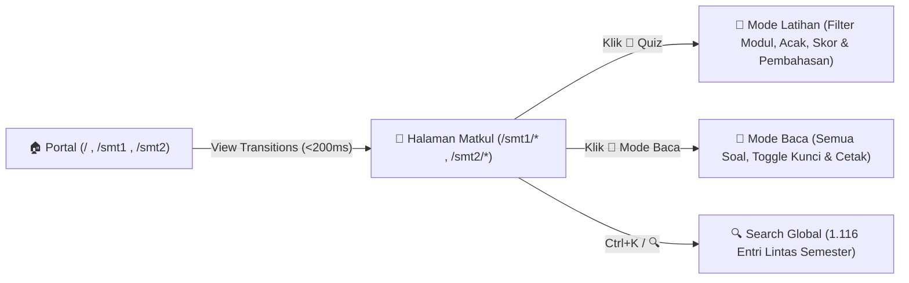

<div align="center">

# 📒 Portal Belajar UT — Sistem Informasi

**Ringkasan Modul BMP, Diagram Visual Interaktif & Bank Soal UOLP (Semester 1 & 2)**  
*Estetika catatan kertas GoodNotes yang super ringan, zero-flicker, dan siap pakai di Desktop maupun Mobile.*

[](https://belajar-ut.azf.my.id)
[](https://astro.build)
[-673ab8?style=for-the-badge&logo=preact&logoColor=white)](https://preactjs.com)
[](https://belajar-ut.azf.my.id/manifest.webmanifest)

[**🌐 Buka Website Production**](https://belajar-ut.azf.my.id) • [**📚 Semester 1**](https://belajar-ut.azf.my.id/smt1) • [**📘 Semester 2**](https://belajar-ut.azf.my.id/smt2)

</div>

---

## ✨ Preview Pengalaman Belajar (Desktop & Mobile)

> [!TIP]
> **Langsung Coba Live:** Buka [**https://belajar-ut.azf.my.id**](https://belajar-ut.azf.my.id) di Desktop maupun Smartphone — tampilan otomatis menyesuaikan dari **Left Sidebar GoodNotes** (Desktop) menjadi **Floating Drawer & Quick Dock** (Mobile).



---

## 🚀 Fitur Unggulan

- **🎨 Desain Modern GoodNotes Paper:** Latar belakang *dotted paper*, *washi tape*, *highlight* pastel, tipografi `Plus Jakarta Sans` + `Caveat`, serta tata letak bersih dan nyaman dibaca lama.
- **⚡ Super Ringan & Zero-Flicker:** Dibangun dengan **Astro SSG + Preact Islands**. Seluruh materi bacaan & **129+ diagram SVG** dikompilasi menjadi HTML statis murni (`0 KB` JS), hanya komponen interaktif (~17,9 KB gzip total) yang memuat JavaScript.
- **🎯 Bank Soal 2 Mode (Latihan & Baca):**
  - **Mode Latihan (Interaktif):** Filter per modul (`M1`–`M9`), acak soal, animasi transisi kartu, feedback benar/salah instan lengkap dengan **pembahasan per opsi A–D**, progress bar, dan penyimpanan skor otomatis di `localStorage`.
  - **Mode Baca:** Tampilan daftar seluruh soal sekaligus dengan opsi A–D vertikal, tombol *Toggle Kunci*, `+ Lihat Pembahasan`, dan tab **Essay** (untuk mata kuliah tipe Essay).
- **🧭 Navigasi Cepat & Floating Dock:** Sidebar kiri di desktop (drawer di mobile) dengan *scroll-spy* otomatis, plus **Menu Floating** (`🎯 Quiz`, `📖 Mode Baca`, `🔍`, `↑`) untuk lompat langsung ke mode latihan dari bagian mana pun.
- **🔍 Pencarian Global Instan (`Ctrl+K`):** Mencari lintas **1.116 entri** (mata kuliah, modul, kata kunci, tokoh ahli, dan bank soal) dari indeks statis `/search-index.json`.
- **🔎 Diagram Visual Zoomable:** Klik diagram SVG mana saja untuk memperbesar dalam modal *lightbox*.
- **📱 PWA & SEO Lengkap:** Mendukung instalasi *Add to Home Screen*, offline cache (`sw.js`), Open Graph, Twitter Card, JSON-LD (`WebSite` & `LearningResource`), `sitemap-index.xml`, dan `robots.txt`.

---

## 📚 Daftar Mata Kuliah (14 Mata Kuliah Aktif)

### Semester 1 (`/smt1/*`)

| Kode BMP | Mata Kuliah | Modul & Diagram | Bank Soal | Link Live |
| :--- | :--- | :---: | :---: | :---: |
| `EKMA415803` | **Perilaku Organisasi** | 9 Modul + Diagram | 95 PG | [Buka](https://belajar-ut.azf.my.id/smt1/perilaku-organisasi) |
| `EMBS4321` | **Sistem Informasi Manajemen** | 9 Modul + Diagram | 108 PG | [Buka](https://belajar-ut.azf.my.id/smt1/sim-manajemen) |
| `MATA4112` | **Aljabar Linear Elementer I** | 6 Modul + Diagram | 68 PG | [Buka](https://belajar-ut.azf.my.id/smt1/aljabar-linear-elementer) |
| `MKWI4202` | **Belajar di Era Digital** | 9 Modul + Diagram | 81 PG | [Buka](https://belajar-ut.azf.my.id/smt1/belajar-di-era-digital) |
| `MSIM4202` | **Struktur Data** | 9 Modul + Diagram | 81 PG | [Buka](https://belajar-ut.azf.my.id/smt1/struktur-data) |
| `MSIM4208` | **Interaksi Manusia & Komputer** | 9 Modul + Diagram | 81 PG | [Buka](https://belajar-ut.azf.my.id/smt1/interaksi-manusia-komputer) |
| `MSIM4303` | **Rekayasa Perangkat Lunak** | 9 Modul + Diagram | 110 PG | [Buka](https://belajar-ut.azf.my.id/smt1/rekayasa-perangkat-lunak) |

### Semester 2 (`/smt2/*`)

| Kode BMP | Mata Kuliah | Modul & Diagram | Bank Soal | Link Live |
| :--- | :--- | :---: | :---: | :---: |
| `STSI4105` | **Basis Data** (`MSIM420601`) | 9 Modul + Diagram | 72 PG | [Buka](https://belajar-ut.azf.my.id/smt2/basis-data) |
| `STSI4206` | **Proses Bisnis** (`STSI420601`) | 6 Modul + Diagram | 91 PG | [Buka](https://belajar-ut.azf.my.id/smt2/proses-bisnis) |
| `STSI4204` | **Analisis & Visualisasi Data** (`MSIM431001`) | 6 Modul + Diagram | 30 PG | [Buka](https://belajar-ut.azf.my.id/smt2/analisis-visualisasi-data) |
| `STSI4308` | **Komunikasi Bisnis & Teknis** (`SKOM443204`) | 9 Modul + Diagram | 45 PG | [Buka](https://belajar-ut.azf.my.id/smt2/komunikasi-bisnis-teknis) |
| `STSI4207` | **Sistem Informasi Manajemen** (`MSIM420701`) | 9 Modul + Diagram | 45 PG + 12 Essay | [Buka](https://belajar-ut.azf.my.id/smt2/sistem-informasi-manajemen) |
| `STSI4402` | **Tata Kelola TI** (`MSIM440201`) | 6 Modul + Diagram | 30 PG + 10 Essay | [Buka](https://belajar-ut.azf.my.id/smt2/tata-kelola-ti) |
| `STSI4208` | **Analisis & Perancangan Sistem** (`MSIM430201`) | 9 Modul + Diagram | 36 PG + 20 Essay | [Buka](https://belajar-ut.azf.my.id/smt2/analisis-perancangan-sistem) |

---

## 🏗️ Arsitektur Project

```text
belajar-ut-astro/
├── public/                 # Asset statis (styles.css, icon*, sw.js, _redirects, search-index.json)
├── src/
│   ├── components/
│   │   ├── CourseSidebar.astro   # Sidebar SSG zero-flicker + floating dock + scroll-spy
│   │   ├── QuizInteractive.tsx   # Preact Island: Mode Latihan, Mode Baca, Essay & localStorage
│   │   └── SearchModal.tsx       # Preact Island: Pencarian global Ctrl+K
│   ├── data/
│   │   ├── catalog.json          # Katalog portal Semester 1 & 2
│   │   └── courses/{smt1,smt2}/  # Data JSON terstruktur 14 mata kuliah
│   ├── layouts/
│   │   └── BaseLayout.astro      # SEO meta, JSON-LD, Google Fonts & View Transitions
│   └── pages/
│       ├── index.astro           # Portal utama (/ , /smt1 , /smt2)
│       ├── smt1/[slug].astro     # Generator statis 7 matkul Semester 1
│       └── smt2/[slug].astro     # Generator statis 7 matkul Semester 2
├── astro.config.mjs
└── netlify.toml                  # Build config Netlify (Node 22, publish dist/)
```

---

## 🛠️ Menjalankan Secara Lokal

Prasyarat: **Node.js >= 22.12.0**

```bash
# 1. Clone repository
git clone https://github.com/azarafath/belajar-ut-sistem-informasi.git
cd belajar-ut-sistem-informasi

# 2. Install dependensi
npm install

# 3. Jalankan dev server lokal
npm run dev

# 4. Build produksi statis ke dist/
npm run build
```

---

<div align="center">

Disusun & dikelola oleh **[Ahmad Zakaria Fathoni](https://azf.my.id)**  
🌐 Production: **[https://belajar-ut.azf.my.id](https://belajar-ut.azf.my.id)**

</div>

