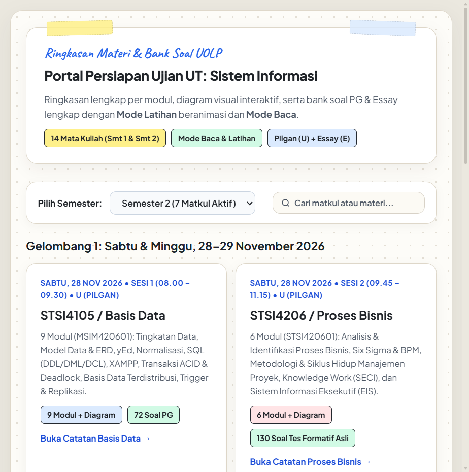
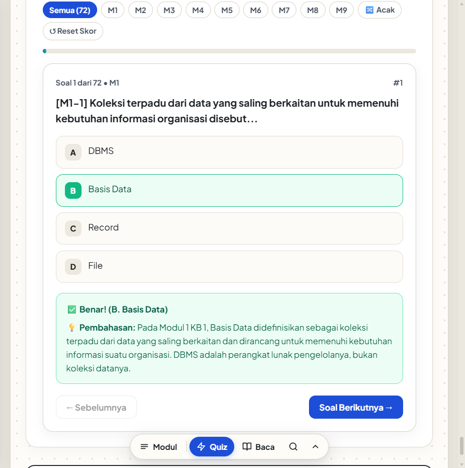
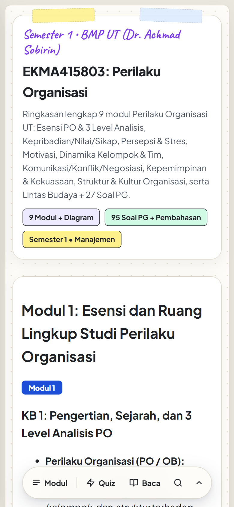

<div align="center">

# Portal Belajar UT: Sistem Informasi

Catatan ringkasan modul BMP, diagram visual, dan latihan soal UOLP untuk mahasiswa Sistem Informasi Universitas Terbuka (Semester 1 & 2).

[](https://belajar-ut.azf.my.id)
[](https://astro.build)
[](https://preactjs.com)
[](https://belajar-ut.azf.my.id/manifest.webmanifest)

[Buka Website](https://belajar-ut.azf.my.id) · [Semester 1](https://belajar-ut.azf.my.id/smt1) · [Semester 2](https://belajar-ut.azf.my.id/smt2)

</div>

---

## Tampilan Desktop & Mobile

### Desktop: Portal Utama & Mode Latihan Quiz

| Portal Utama (Desktop) | Mode Latihan Quiz & Pembahasan |
| :---: | :---: |
|  |  |

### Mobile: Navigasi & Floating Dock

<p align="center">
  
</p>

---

## Fitur Utama

- **Arsitektur Statis Ringan:** Dibangun dengan Astro SSG dan Preact Islands. Seluruh materi bacaan dan diagram SVG dikompilasi menjadi HTML statis murni; total JavaScript klien untuk kuis interaktif, pencarian, dan transisi halaman hanya ~17,9 KB (gzip).
- **Bank Soal Dua Mode (1.036 Soal PG + 42 Essay):**
  - **Mode Latihan:** Filter soal per modul (`M1`–`M9`), acak urutan soal, progress bar, feedback instan saat memilih jawaban beserta pembahasannya, dan skor tersimpan otomatis di `localStorage`.
  - **Mode Baca:** Tampilan seluruh soal dalam satu halaman dengan opsi vertikal, tombol sembunyikan kunci jawaban, panel pembahasan per opsi, serta tab khusus soal Essay.
- **Navigasi Cepat Lintas Perangkat:** Sidebar kiri permanen di desktop dan drawer di mobile dengan *scroll-spy* aktif, ditambah floating dock (`Quiz`, `Baca`, `Cari`, `Atas`) untuk melompat ke latihan soal dari bagian mana pun.
- **Pencarian Global (`Ctrl+K`):** Mencari lintas **1.116 entri** (mata kuliah, modul, tokoh ahli, dan soal) dari indeks statis `/search-index.json`.
- **Diagram Visual Interaktif:** Setiap diagram SVG pada materi dapat diklik untuk diperbesar.
- **Siap Offline & SEO:** Mendukung instalasi PWA (`sw.js`, `manifest.webmanifest`), skema JSON-LD (`WebSite` dan `LearningResource`), `sitemap-index.xml`, dan redirect 301 di Netlify.

---

## Daftar Mata Kuliah

### Semester 1 (`/smt1/*`)

| Kode BMP | Mata Kuliah | Materi | Bank Soal | Tautan |
| :--- | :--- | :---: | :---: | :---: |
| `EKMA415803` | Perilaku Organisasi | 9 Modul + Diagram | 95 PG | [Buka](https://belajar-ut.azf.my.id/smt1/perilaku-organisasi) |
| `EMBS4321` | Sistem Informasi Manajemen | 9 Modul + Diagram | 108 PG | [Buka](https://belajar-ut.azf.my.id/smt1/sim-manajemen) |
| `MATA4112` | Aljabar Linear Elementer I | 6 Modul + Diagram | 68 PG | [Buka](https://belajar-ut.azf.my.id/smt1/aljabar-linear-elementer) |
| `MKWI4202` | Belajar di Era Digital | 9 Modul + Diagram | 81 PG | [Buka](https://belajar-ut.azf.my.id/smt1/belajar-di-era-digital) |
| `MSIM4202` | Struktur Data | 9 Modul + Diagram | 81 PG | [Buka](https://belajar-ut.azf.my.id/smt1/struktur-data) |
| `MSIM4208` | Interaksi Manusia & Komputer | 9 Modul + Diagram | 81 PG | [Buka](https://belajar-ut.azf.my.id/smt1/interaksi-manusia-komputer) |
| `MSIM4303` | Rekayasa Perangkat Lunak | 9 Modul + Diagram | 110 PG | [Buka](https://belajar-ut.azf.my.id/smt1/rekayasa-perangkat-lunak) |

### Semester 2 (`/smt2/*`)

| Kode BMP | Mata Kuliah | Materi | Bank Soal | Tautan |
| :--- | :--- | :---: | :---: | :---: |
| `STSI4105` | Basis Data (`MSIM420601`) | 9 Modul + Diagram | 72 PG | [Buka](https://belajar-ut.azf.my.id/smt2/basis-data) |
| `STSI4206` | Proses Bisnis (`STSI420601`) | 6 Modul + Diagram | 91 PG | [Buka](https://belajar-ut.azf.my.id/smt2/proses-bisnis) |
| `STSI4204` | Analisis & Visualisasi Data (`MSIM431001`) | 6 Modul + Diagram | 30 PG | [Buka](https://belajar-ut.azf.my.id/smt2/analisis-visualisasi-data) |
| `STSI4308` | Komunikasi Bisnis & Teknis (`SKOM443204`) | 9 Modul + Diagram | 45 PG | [Buka](https://belajar-ut.azf.my.id/smt2/komunikasi-bisnis-teknis) |
| `STSI4207` | Sistem Informasi Manajemen (`MSIM420701`) | 9 Modul + Diagram | 45 PG + 12 Essay | [Buka](https://belajar-ut.azf.my.id/smt2/sistem-informasi-manajemen) |
| `STSI4402` | Tata Kelola TI (`MSIM440201`) | 6 Modul + Diagram | 30 PG + 10 Essay | [Buka](https://belajar-ut.azf.my.id/smt2/tata-kelola-ti) |
| `STSI4208` | Analisis & Perancangan Sistem (`MSIM430201`) | 9 Modul + Diagram | 36 PG + 20 Essay | [Buka](https://belajar-ut.azf.my.id/smt2/analisis-perancangan-sistem) |
| `MSIM431201` | Metodologi Penelitian (Non-UAS) | 9 Modul + Diagram | 63 PG | [Buka](https://belajar-ut.azf.my.id/smt2/metodologi-penelitian) |

---

## Struktur Project

```text
belajar-ut-astro/
├── docs/screenshots/         # Screenshot tampilan desktop & mobile
├── public/                   # Asset statis (styles.css, icon*, sw.js, _redirects, search-index.json)
├── src/
│   ├── components/
│   │   ├── CourseSidebar.astro   # Sidebar SSG, drawer mobile, floating dock & scroll-spy
│   │   ├── QuizInteractive.tsx   # Preact Island: Mode Latihan, Mode Baca, Essay & localStorage
│   │   └── SearchModal.tsx       # Preact Island: Pencarian global Ctrl+K
│   ├── data/
│   │   ├── catalog.json          # Katalog portal Semester 1 & 2
│   │   └── courses/{smt1,smt2}/  # Data JSON terstruktur 14 mata kuliah
│   ├── layouts/
│   │   └── BaseLayout.astro      # Metadata SEO, JSON-LD, Google Fonts & View Transitions
│   └── pages/
│       ├── index.astro           # Portal utama (/, /smt1, /smt2)
│       ├── smt1/[slug].astro     # Halaman statis 7 matkul Semester 1
│       └── smt2/[slug].astro     # Halaman statis 7 matkul Semester 2
├── astro.config.mjs
└── netlify.toml                  # Konfigurasi build Netlify (Node 22, publish dist/)
```

---

## Menjalankan Secara Lokal

Prasyarat: **Node.js >= 22.12.0**

```bash
git clone https://github.com/azarafath/belajar-ut-sistem-informasi.git
cd belajar-ut-sistem-informasi
npm install
npm run dev
```

Untuk membuat build produksi statis ke folder `dist/`:

```bash
npm run build
```

---

Disusun oleh **[Ahmad Zakaria Fathoni](https://azf.my.id)** · Production: **[belajar-ut.azf.my.id](https://belajar-ut.azf.my.id)**
